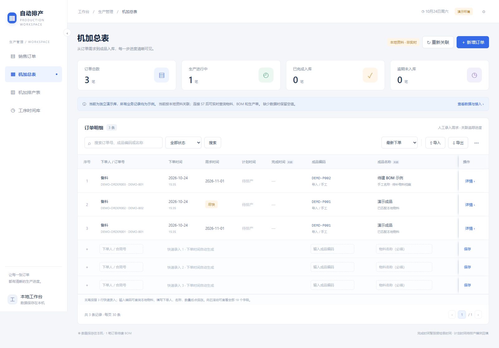

# 自动排产工作台 · 机加总表

面向 Windows 的本机生产订单跟踪工具。使用 Node.js、SQLite 和原生网页实现订单录入、BOM 子件、生产进度、采购状态及备份恢复，并提供可配置的 S7 只读适配层。

当前版本 **v1.0.1**。首版实现机加总表；销售订单、机加排产表、工序时间库保留入口，尚未实现设备排程算法。



## 功能

- 表单新增和表格末尾三行快速录入；编辑、删除、搜索、排序、分页与持久化。
- 19 项总表字段及人工补充字段，完整保留一对多 BOM 子件。
- 按生产单头、行主键关联单据，五个阶段各占 20%；数量仅统计最终生产检验。
- 采购进度按 BOM 子件显示，明确标注“物料级 · 非本单专属”。
- UTF-8 CSV / JSON 导入、CSV 导出、完整备份与恢复、操作记录。
- 提交幂等、并发编辑冲突提示、查询失败保留历史快照；来源和失败信息可追溯。
- 独立演示库，所有示例均为虚构数据；无需 ERP 账号即可试用。

## Windows 便携版

从 [Releases](https://github.com/Miao9201/machining-scheduler/releases) 下载 `machining-scheduler-v1.0.1-windows-x64.zip`，解压到可写目录。

1. 双击 `启动工作台.cmd`，打开 <http://127.0.0.1:18787/>。
2. 或双击 `启动演示.cmd`，打开 <http://127.0.0.1:18788/>，体验独立演示库。
3. 使用 `停止服务.cmd` 结束本项目服务。关闭网页不会停止后台服务。

便携包自带 Node.js 24 和应用依赖，不包含浏览器、业务数据或账号。CMD 入口会调用同目录 PowerShell 脚本；也可直接运行 `powershell -NoProfile -ExecutionPolicy Bypass -File .\start.ps1`。

## 从源码运行

需要 Node.js **24 或以上**。已测试 Windows；部分本地流程可用于其他系统，但启动脚本和保存账号使用 Windows 功能。

```powershell
git clone https://github.com/Miao9201/machining-scheduler.git
cd machining-scheduler
npm ci
npm start
```

演示模式：`node src/server.js --demo`。自定义端口或数据位置可设置环境变量：

```powershell
$env:PORT = '18787'
$env:DATA_DIR = './data'
npm start
```

## 配置与连接 S7

公开版已移除私有部署地址、人员名单、真实物料及订单、内部需求和联调记录。适配器默认指向不含任何公司信息的本机地址，不会主动连接某个企业系统。

```powershell
$env:S7_BASE_URL = 'https://erp.example.com'
.\start.ps1
```

源码运行也可复制 `.env.example` 为 `.env`，编辑后执行 `node --env-file=.env src/server.js`。普通 `npm start` 不会自动读取 `.env`。

| 变量 | 用途 |
|---|---|
| `S7_BASE_URL` | 获准访问的 S7 系统基础地址；默认 `http://127.0.0.1:18088` |
| `CHROME_PATH` | 自定义 Chrome/Edge 可执行文件；Windows 常见安装位置会自动查找 |
| `PORT` | 网页端口，正式库默认 18787，演示库默认 18788 |
| `DATA_DIR` | 业务库目录，默认项目内 `data/`，演示库默认为 `data-demo/` |

在“数据与接入”中填写获准查询的账号，账套可选。Windows 可加密保存账号，仅当前用户可解密；账号不进入业务备份。强制登录可能使同账号原会话退出，须明确勾选。演示库禁止连接真实 S7。

适配器通过页面登录和查询接口工作，不包含 S7 商业软件源码，也不提供厂商稳定 API 的保证。不同部署、版本或权限可能需要调整映射；请先在授权环境对账。菜单和字段约定见 [数据行为](docs/data-model.md)。

## 数据与升级

- `data/`、`data-demo/` 保存本机数据，复制项目给其他人时应排除。
- 升级前下载完整备份、停止服务，保留数据目录，再替换程序文件。
- JSON 备份包含本工具订单、来源资料、快照和操作记录，不包含密码；上限 128MB。
- 恢复会替换当前数据；先校验，在事务中恢复，并自动保存恢复前备份。
- CSV 只是查看用导出，不能替代完整备份。导入 BOM 时必须包含本批涉及成品的完整子件清单。

## 验证

```powershell
npm run check
npm test
npx playwright install chromium
$env:CHROME_PATH = node --input-type=module -e "import {chromium} from 'playwright'; console.log(chromium.executablePath())"
npm run test:ui
```

核心测试 35 项；浏览器检查 21 项（6 项竞态/绑定回归、15 项完整流程）。测试使用虚构资料和临时本地库，不需要真实 ERP 账号。CI 在 Windows 执行相同检查，见 [Actions](https://github.com/Miao9201/machining-scheduler/actions)。

## 目录

```text
src/          HTTP 服务、SQLite、校验和 S7 适配器
public/       原生 HTML / CSS / JavaScript 界面
tests/        核心测试和浏览器回归
samples/      虚构 CSV / JSON 模板
docs/         数据行为与演示截图
LICENSES/     便携包所用运行时的许可
```

## 常见问题与限制

- **没有物料/BOM？** 可先导入模板或手工填写名称。缺失数量保留空值；无 BOM 留空提示，多个生效主 BOM 会报冲突。
- **进度如何计算？** 按最新有效生产单据映射五阶段。工序检验和采购检验不计入最终生产数量；源报表只有日期时，同日按阶段确定顺序并标注精度。
- **完成时间为何不是入库时间？** 当前定义为生产报检时间；计划时间待排程模块回填。采用本工具前需确认这些口径适合本单位。
- **能多人共享吗？** 当前仅监听本机回环地址，无多人身份权限。正式共享部署需另行设计统一服务、身份权限、TLS、数据库和备份运维。
- **能访问其他电脑的已保存账号吗？** 不能。Windows 加密账号不随便携包分发，请在目标电脑自行配置。

## 许可证

本项目代码采用 [MIT](LICENSE)。Node.js、Playwright 等仍遵循各自许可，见 [THIRD_PARTY.md](THIRD_PARTY.md)。开源授权不包含任何 ERP 系统、账号、企业资料或商标权。

欢迎按 [贡献指南](CONTRIBUTING.md) 提交问题或改进。请勿在公开 issue、附件或截图中包含实际订单、账号或内部地址。
